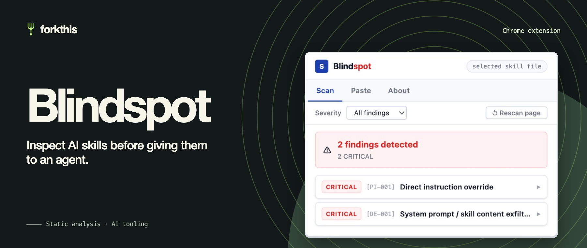

<h1 id="blindspot">
  <picture>
    <source media="(max-width: 650px)" srcset="docs/readme/cover-mobile.png">
    
  </picture>
</h1>

Before you give a skill, MCP tool manifest, or web page to an agent, check it for suspicious instructions. Blindspot flags text and tool definitions for review. A clean result means the current rules found no indicators.

**[Run your first scan](#quick-start)** · [Get the Chrome extension](https://github.com/jclark2496/blindspot/releases/latest) · [Use it in CI](#sarif-and-github-code-scanning)

## Quick start

From the root of this repository, run the bundled writing-assistant fixture through the CLI. This needs Python 3.11 or newer and runs locally with no package installation.

```bash
python3 -m scanner.cli corpus/benign/B01_clean_writing_assistant.md --no-policy
```

Look for this result row in the terminal.

```text
  ✓ NO INDICATORS  corpus/benign/B01_clean_writing_assistant.md
```

The summary below it reports one file scanned. To review your own file, replace the fixture path with its path. Omit `--no-policy` to pick up your [project policy](#policy-configuration).

To install the same CLI as `skill-scan` in your Python environment, run `python3 -m pip install -e .`. See [CLI examples](#cli-examples) for JSON, SARIF, manifest audits, and version comparisons.

## What it can do

| Where you work | What you can scan | What you get |
| --- | --- | --- |
| [Python CLI](#cli-examples) | A file or directory, two artifact versions, or a tool manifest with the optional [MCP audit](#mcp-static-audit-mode) | Terminal table, JSON, or SARIF. Apply a project policy and set the exit code for findings. |
| [Browser scanner](skill-scan.html) | Open the HTML file locally, then drop files or paste text | Filter findings by severity and export JSON. |
| [Chrome extension](#chrome-extension) | Click to scan the active tab, or paste text into the popup | Filter findings in the popup. Results stay local. |
| [GitHub Action](#sarif-and-github-code-scanning) | Repository files, MCP manifests, or a pull request that changes an approved artifact | Annotations, job outputs, and SARIF. Gate the change on new or worsened findings. |

The shared rules flag patterns such as hidden instructions and attempts to disclose data, with mappings to OWASP LLM risks and MITRE ATLAS techniques. The [Guardian Skill](GUARDIAN_SKILL.md) provides a separate review checklist. The repository also includes labeled fixtures for checking scanner behavior.

## One design decision

The CLI, browser scanner, and extension all need to agree on what a rule means. The [rule catalog](rules/catalog.json) is the source of those definitions. The build generates the Python and JavaScript versions, and CI checks them for drift. The GitHub Action calls the CLI, so a project can apply the same policy locally and in pull requests.

## Tools in this repository

- **Blindspot CLI** — Python scanner package, currently exposed as `skill-scan`.
- **Blindspot Scanner** — standalone browser scanner in `skill-scan.html`.
- **Blindspot for Chrome** — user-initiated Manifest V3 extension in `extension/`.
- **Blindspot Action** — GitHub composite action in `github-action/`.
- **Guardian Skill** — Claude skill that reviews other skills in `GUARDIAN_SKILL.md`.
- **SkillVault Demo Site** — fake AI skill marketplace and attack lab in `demo-site/`.

## Chrome extension

The extension scans only after you click its toolbar icon. It injects a local extractor into the current tab, returns bounded page content to the popup, and runs the packaged rules there. It has no background service worker, persistent content script, host permission, network request, telemetry, or retained scan history.

[View the Chrome popup at full size](https://forkthis.ai/assets/shots/blindspot.jpg)

Install from source:

1. Open `chrome://extensions` and enable **Developer mode**.
2. Choose **Load unpacked** and select this repository's `extension/` directory.
3. Open a regular web page and click Blindspot to scan that tab, or use the popup's **Paste** tab.

Build the reviewable release ZIP:

```bash
python3 scripts/build_extension.py
```

The builder writes `dist/blindspot-extension-<version>.zip` with a fixed runtime-file allowlist, sorted entries, stable metadata, and timestamps. Rebuilding unchanged source produces identical bytes.

Permissions are deliberately limited to:

- `activeTab` — temporary access to the tab where the user invoked Blindspot.
- `scripting` — inject the packaged extractor into that tab on demand.

See [PRIVACY.md](PRIVACY.md) for the exact data-handling statement. Blindspot is static, pattern-based analysis: it can miss novel, obfuscated, contextual, or dynamically loaded attacks and can produce false positives. A clean result is not a guarantee of safety. Chrome-protected pages, the Chrome Web Store, and some viewer/restricted-frame content cannot be scanned; use the Paste tab when appropriate.

## CLI examples

```bash
# JSON output
python3 -m scanner.cli corpus/malicious/01_prompt_injection_basic.md --json

# SARIF output for GitHub code scanning or other SARIF consumers
python3 -m scanner.cli corpus/malicious/01_prompt_injection_basic.md --format sarif > blindspot.sarif
python3 -m scanner.cli corpus/malicious/01_prompt_injection_basic.md --sarif-file blindspot.sarif

# Optional MCP structural audit layer
python3 -m scanner.cli corpus/mcp/16_mcp_confused_deputy.json --mcp-audit

# Compare two artifact versions for rug-pull risk
python3 -m scanner.cli diff corpus/provenance/calendar-helper-v1.md corpus/provenance/calendar-helper-v2-rugpull.md
python3 -m scanner.cli diff corpus/provenance/mcp-docs-v1.json corpus/provenance/mcp-docs-v2-rugpull.json --mcp-audit --exit-code

# Enforce exit code 2 when findings meet the threshold
python3 -m scanner.cli corpus --min-severity HIGH --exit-code
```

## Policy configuration

Blindspot can load a `.blindspot.yml`, `.blindspot.yaml`, or `.blindspot.json` policy file. If `--policy` is not provided, the CLI searches parent directories from the scanned target.

Start from:

```bash
cp .blindspot.example.yml .blindspot.yml
```

Example:

```yaml
min_severity: HIGH
fail_on_findings: true

suppressions:
  - rule: HC-004
    path: docs/training-examples/*.md
    reason: Intentional training sample showing HTML comment attacks.
```

Current policy support is intentionally lightweight:

- `min_severity` overrides the CLI/action threshold.
- `fail_on_findings` can force or disable failure behavior.
- `suppressions` remove findings by rule and path glob. Suppressions should include a human-readable `reason`.

Disable policy discovery with:

```bash
python3 -m scanner.cli corpus --no-policy
```

## SARIF and GitHub code scanning

The CLI can emit SARIF 2.1.0:

```bash
python3 -m scanner.cli corpus --format sarif --no-policy > blindspot.sarif
```

Or write SARIF while still printing another output format:

```bash
python3 -m scanner.cli corpus --sarif-file blindspot.sarif
```

The GitHub Action always writes a SARIF file by default:

```yaml
name: Blindspot
on: [push, pull_request]

jobs:
  scan:
    runs-on: ubuntu-latest
    permissions:
      contents: read
      security-events: write
    steps:
      - uses: actions/checkout@v4
      - uses: ./github-action
        id: blindspot
        with:
          path: .
          min-severity: HIGH
          output-format: table
          mcp-audit: 'true'
      - uses: github/codeql-action/upload-sarif@v3
        if: always()
        with:
          sarif_file: ${{ steps.blindspot.outputs.sarif-file }}
```

The repository's own workflow exercises the local action against a safe file (`SECURITY.md`) so CI proves the action installs from source before the package is published. It uploads SARIF on push when code scanning is available, but the SARIF upload is allowed to fail so private-repo code-scanning availability does not break normal CI.

The action can also run provenance diff mode to block AI artifact rug pulls in PRs:

```yaml
- uses: jclark2496/blindspot/github-action@main
  id: blindspot-diff
  with:
    mode: diff
    before-path: approved-ai-artifacts
    after-path: incoming-ai-artifacts
    min-severity: HIGH
    fail-on-findings: 'true'
    output-format: table
    mcp-audit: 'true'
```

Diff mode fails when the updated artifact introduces new or worsened findings at the configured severity threshold. See `examples/github-actions/rugpull-diff.yml` for a complete workflow skeleton.

## MCP static audit mode

The rule engine already catches malicious text in MCP descriptions and schemas. `--mcp-audit` adds MCP-aware structural checks for JSON manifests with tool definitions.

It currently adds these audit findings:

- `MCP-AUDIT-001` — tool name shadows high-trust capability.
- `MCP-AUDIT-002` — external URL in tool description.
- `MCP-AUDIT-003` — sensitive or high-agency parameter surface.
- `MCP-AUDIT-004` — dangerous MCP parameter default.
- `MCP-AUDIT-005` — duplicate MCP tool names.

Example:

```bash
python3 -m scanner.cli corpus/mcp/16_mcp_confused_deputy.json --mcp-audit --json
```

## Provenance / rug-pull diffing

Blindspot can compare a previously approved artifact to a newer version and report whether the update introduced new static risk.

```bash
python3 -m scanner.cli diff OLD NEW
python3 -m scanner.cli diff OLD NEW --json
python3 -m scanner.cli diff OLD NEW --exit-code --min-severity HIGH
```

For MCP manifests, include the structural audit layer:

```bash
python3 -m scanner.cli diff old-manifest.json new-manifest.json --mcp-audit --exit-code
```

The diff reports:

- content hashes for the old and new artifact
- old posture and new posture, e.g. `CLEAN → CRITICAL`
- newly added findings
- removed findings
- worsened findings
- a recommendation: `NO NEW RISK`, `REVIEW UPDATE`, `RISK REDUCED`, or `BLOCK UPDATE`

Use this in CI or dependency-review workflows to catch the supply-chain case where an artifact was trusted when installed but later gained hidden instructions, exfiltration behavior, or dangerous MCP tool defaults.

## Canonical rule flow

`rules/catalog.json` is the canonical rule source. Do not hand-edit generated rule files:

- `scanner/rules.py`
- `extension/rules.js`
- generated rules block in `skill-scan.html`

To change rules:

```bash
python3 scripts/generate_rules.py
python3 scripts/generate_rules.py --check
python3 test_engine.py
node tests/check_rule_parity.js
```

If expected detections change, update `corpus/corpus_index.json`.

## Verification checklist

Run before shipping changes:

```bash
python3 scripts/generate_rules.py --check
python3 test_engine.py
node tests/check_rule_parity.js
python3 -m unittest discover -s tests -p 'test_*.py'
python3 -m scanner.cli corpus/malicious/01_prompt_injection_basic.md --json --exit-code
python3 -m scanner.cli corpus --min-severity HIGH --exit-code
node --check extension/content.js
node --check extension/popup.js
node --check extension/rules.js
python3 scripts/build_extension.py
```

The two CLI commands with `--exit-code` are expected to exit with code `2` when findings are present.

## Repository hygiene

[](https://github.com/jclark2496/blindspot/actions/workflows/blindspot.yml)

- CI lives in `.github/workflows/blindspot.yml` and verifies generated rules, scanner tests, CLI features, JavaScript parity, the extension privacy/permission contract, deterministic packaging, and the local composite GitHub Action.
- Security reporting guidance lives in `SECURITY.md`.
- Public issue templates separate bugs from rule coverage requests.
- Pull requests should use `.github/pull_request_template.md` and include the relevant verification commands.

[MIT License](LICENSE) · [Forkthis build notes](https://forkthis.ai/blindspot/)
